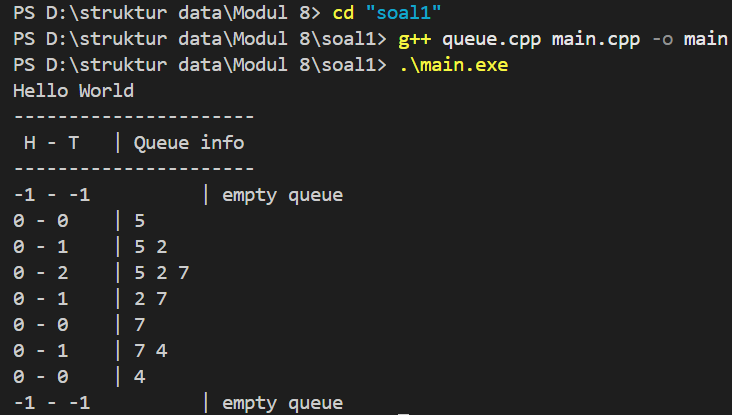
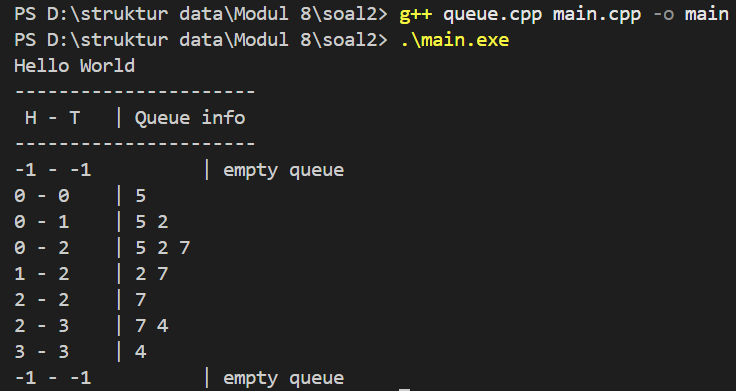

# Laporan Praktikum Modul 8 - Queue

Shafira Shifa Azahra - 109082500125

## Dasar Teori

Queue atau antrean adalah struktur data linear yang menerapkan prinsip FIFO (First In First Out), yaitu elemen yang pertama masuk akan menjadi elemen yang pertama keluar. Cara kerjanya mirip antrean di dunia nyata, misalnya antrean di loket: orang yang datang lebih dulu dilayani lebih dulu, dan orang baru selalu masuk dari belakang.

### A. Konsep dan Operasi Dasar Queue<br/>

Queue memiliki dua penunjuk utama, yaitu head (elemen paling depan, tempat elemen keluar) dan tail (elemen paling belakang, tempat elemen masuk).

#### 1. Enqueue

Enqueue adalah operasi menambahkan elemen baru di bagian belakang queue (posisi tail). Pada queue yang masih kosong, head dan tail sama-sama menunjuk ke elemen pertama tersebut.

#### 2. Dequeue

Dequeue adalah operasi mengambil elemen dari bagian depan queue (posisi head). Setelah elemen terakhir diambil, queue kembali kosong.

#### 3. isEmptyQueue dan isFullQueue

isEmptyQueue memeriksa apakah queue kosong, sedangkan isFullQueue memeriksa apakah queue sudah penuh. Pemeriksaan penuh hanya diperlukan pada queue berbasis array karena kapasitasnya tetap, sedangkan queue berbasis linked list bersifat dinamis.

## Guided

### 1. Queue dengan Linked List

**queue.h**

```C
#ifndef QUEUE_H_INCLUDE
#define QUEUE_H_INCLUDE

#include <iostream>
using namespace std;

#define Nil NULL

typedef bool boolean;
typedef int infotype;
typedef struct elmQ *address;

struct elmQ {
    infotype info;
    address next;
};

struct queue {
    address head, tail;
};

boolean isEmpty(queue Q);
void CreateQueue(queue &Q);
address alokasi(infotype X);
void dealokasi(address P);
address findElm(queue Q, infotype X);
boolean fFindElm(queue Q, address P);
void insert(queue &Q, address P);
void deleteQueue(queue &Q, address &P);
void printInfo(queue Q);
int nbList(queue Q);
void delAll(queue &Q);

#endif
```

**queue.cpp**

```C
#include "queue.h"

boolean isEmpty(queue Q) {
    return (Q.head == Nil);
}

void CreateQueue(queue &Q) {
    Q.head = Nil;
    Q.tail = Nil;
}

address alokasi(infotype X) {
    address P = new (nothrow) elmQ;
    if (P != Nil) {
        P->info = X;
        P->next = Nil;
    }
    return P;
}

void dealokasi(address P) {
    delete P;
}

address findElm(queue Q, infotype X) {
    address P = Q.head;
    while (P != Nil) {
        if (P->info == X) {
            return P;
        }
        P = P->next;
    }
    return Nil;
}

boolean fFindElm(queue Q, address P) {
    address R = Q.head;
    while (R != Nil) {
        if (R == P) {
            return true;
        }
        R = R->next;
    }
    return false;
}

void insert(queue &Q, address P) {
    if (isEmpty(Q)) {
        Q.head = P;
        Q.tail = P;
    } else {
        (Q.tail)->next = P;
        Q.tail = P;
    }
}

void deleteQueue(queue &Q, address &P) {
    P = Q.head;
    if (Q.head == Q.tail) {
        Q.head = Nil;
        Q.tail = Nil;
    } else {
        Q.head = P->next;
    }
    P->next = Nil;
}

void printInfo(queue Q) {
    if (isEmpty(Q)) {
        cout << "Queue kosong" << endl;
    } else {
        address P = Q.head;
        while (P != Nil) {
            cout << P->info << " ";
            P = P->next;
        }
        cout << endl;
    }
}

int nbList(queue Q) {
    int jumlah = 0;
    address P = Q.head;
    while (P != Nil) {
        jumlah++;
        P = P->next;
    }
    return jumlah;
}

void delAll(queue &Q) {
    address P;
    while (!isEmpty(Q)) {
        deleteQueue(Q, P);
        dealokasi(P);
    }
}
```

**main.cpp**

```C
#include <iostream>
#include "queue.h"
using namespace std;

int main() {
    queue Q;
    address P;

    CreateQueue(Q);
    cout << "isEmpty: " << isEmpty(Q) << endl;
    printInfo(Q);

    insert(Q, alokasi(5));
    insert(Q, alokasi(2));
    insert(Q, alokasi(7));
    cout << "Setelah insert 5, 2, 7" << endl;
    printInfo(Q);
    cout << "nbList : " << nbList(Q) << endl;

    P = findElm(Q, 2);
    if (P != Nil) {
        cout << "findElm(2) ketemu, info = " << P->info << endl;
        cout << "fFindElm : " << fFindElm(Q, P) << endl;
    }
    if (findElm(Q, 9) == Nil) {
        cout << "findElm(9) tidak ketemu" << endl;
    }

    deleteQueue(Q, P);
    cout << "Setelah delete, elemen yang keluar = " << P->info << endl;
    dealokasi(P);
    printInfo(Q);

    delAll(Q);
    cout << "Setelah delAll" << endl;
    printInfo(Q);
    cout << "isEmpty: " << isEmpty(Q) << endl;

    return 0;
}
```

Pada guided ini, queue dibuat menggunakan single linked list. Setiap elemen (elmQ) berisi data dan pointer next, sedangkan queue memiliki pointer head dan tail. Fungsi alokasi digunakan untuk membuat elemen baru, kemudian insert untuk menambahkan elemen ke bagian belakang queue. Sementara itu, deleteQueue digunakan untuk mengambil elemen dari bagian depan sesuai prinsip FIFO (First In First Out). Terdapat juga fungsi findElm dan fFindElm untuk mencari data, nbList untuk menghitung jumlah elemen, serta delAll untuk menghapus seluruh elemen. Pada program utama, dimasukkan tiga elemen, yaitu 5, 2, dan 7. Setelah itu, elemen paling depan, yaitu 5, dihapus sehingga tersisa 2 dan 7. Terakhir, semua elemen yang tersisa dihapus menggunakan fungsi delAll.

### 2. Queue dengan Array (data nama)

**queue.h**

```C
#ifndef QUEUE_H
#define QUEUE_H

#include <string>
using namespace std;

const int MAKSIMAL = 5;

struct queue {
    string nama[MAKSIMAL];
    int head, tail;
};

bool isEmpty(queue Q);
bool isFull(queue Q);
void CreateQueue(queue &Q);
void enQueue(queue &Q, string nama);
void deQueue(queue &Q);
void viewQueue(queue Q);

#endif
```

**queue.cpp**

```C
#include "queue.h"
#include <iostream>

using namespace std;

// NOTE :
// Implementasi 1 = head diam, tail bergerak (Queue Linear Statis, kerana head nya tetap diam)
// Implementasi 2 = head bergerak, tail bergerak (Queue Linear Dinamis, karena head & tail nya sama-sama bergerak)
// Implementasi 3 = head dan tail berputar (Queue Circular, karena jika udh mentok tapi masih ada space, diputar sehingga tail bisa ada didepan head)

bool isEmpty(queue Q){
    if(Q.head == -1 && Q.tail == -1){
        return true;
    } else {
        return false;
    }
}

//isFull implmenetasi 1 & 2
bool isFull(queue Q){
    if(Q.tail == MAKSIMAL - 1){
        return true;
    } else {
        return false;
    }
}

// //isFull implementasi 3
// bool isFull(queue Q){
//     if((Q.tail + 1) % MAKSIMAL == Q.head){
//         return true;
//     } else {
//         return false;
//     }
// }

void CreateQueue(queue &Q){ //terbentuk queue dengan head = -1 dan tail = -1
    Q.head = -1;
    Q.tail = -1;
}

//enqueue implementasi 1 & 2
void enQueue(queue &Q, string nama){
    if(isFull(Q) == true){
        cout << "Queue sudah penuh!" << endl;
    } else {
        if(isEmpty(Q) == true){
            Q.head = Q.tail = 0;
        } else {
            Q.tail++;
        }
        Q.nama[Q.tail] = nama;
        cout << "nama " << nama << " berhasil ditambahkan kedalam queue!" << endl;
    }
}

// //enQueue implementasi 3
// void enQueue(queue &Q, string nama){
//     if(isFull(Q) == true){
//         cout << "Queue sudah penuh!" << endl;
//     } else {
//         if(isEmpty(Q) == true){
//             Q.head = Q.tail = 0;
//         } else {
//             Q.tail = (Q.tail + 1) % MAKSIMAL; // bergerak melingkar
//         }
//         Q.nama[Q.tail] = nama;
//         cout << "nama " << nama << " berhasil ditambahkan kedalam queue!" << endl;
//     }
// }

//dequeue implementasi 1
void deQueue(queue &Q){
    if(isEmpty(Q) == true){
        cout << "Queue kosong!" << endl;
    } else {
        cout << "Mengahapus data " << Q.nama[Q.head] << "..." << endl;
        for(int i = 0; i < Q.tail; i++){
            Q.nama[i] =  Q.nama[i+1];
        }
        Q.tail--;
        if(Q.tail < 0){ //kalo semua isi queue nya udh dikelaurin, set head & tail ke -1
            Q.head = -1;
            Q.tail = -1;
        }
    }
}

// //dequeue implementasi 2
// void deQueue(queue &Q){
//     if(isEmpty(Q) == true){
//         cout << "Queue kosong!" << endl;
//     } else {
//         cout << "Mengahapus data " << Q.nama[Q.head] << "..." << endl;
//         Q.head++;
//         if(Q.head > Q.tail){ //kalo elemennya udh abis (head akan lebih 1 dari tail), maka reset ulang head & tail ke -1
//             Q.head = -1;
//             Q.tail = -1;
//         }
//     }
// }

// //deQueue implementasi 3
// void deQueue(queue &Q){
//     if(isEmpty(Q) == true){
//         cout << "Queue kosong!" << endl;
//     } else {
//         cout << "Mengahapus data " << Q.nama[Q.head] << "..." << endl;
//         if(Q.head == Q.tail){ //kalo elemennya tinggal 1, langsungkan saja head & tail nya reset ke -1
//             Q.head = -1;
//             Q.tail = -1;
//         } else {
//             Q.head = (Q.head + 1) % MAKSIMAL; // bergerak melingkar
//         }
//     }
// }

//viewQueue implementasi 1 & 2
void viewQueue(queue Q){
    if(isEmpty(Q) == true){
        cout << "Queue kosong!" << endl;
    } else {
        for(int i = Q.head; i <= Q.tail; i++){
            cout << i -  Q.head + 1 << ". " << Q.nama[i] << endl;
        }
    }
    cout << endl;
}

// //viewQueue implementasi 3
// void viewQueue(queue Q){
//     if(isEmpty(Q) == true){
//         cout << "Queue kosong!" << endl;
//     } else {
//         int i = Q.head;
//         int count = 1;
//         while(true){
//             cout << count << ". " << Q.nama[i] << endl;
//             if(i == Q.tail){
//                 break;
//             }
//             i = (i + 1) % MAKSIMAL;
//             count++;
//         }
//     }
// }
```

**main.cpp**

```C
#include "queue.h"
#include <iostream>

using namespace std;

int main(){
    queue Q;

    CreateQueue(Q);
    enQueue(Q, "Dimas");
    enQueue(Q, "Arvin");
    enQueue(Q, "Rizal");
    enQueue(Q, "Hafizh");
    enQueue(Q, "Fathur");
    enQueue(Q, "Daffa");
    cout << endl;

    cout << "--- Isi Queue Setelah enQueue ---" << endl;
    viewQueue(Q);
    cout << endl;

    deQueue(Q);
    deQueue(Q);
    deQueue(Q);
    deQueue(Q);
    // deQueue(Q);
    // deQueue(Q);
    cout << endl;

    cout << "--- Isi Queue Setelah deQueue ---" << endl;
    viewQueue(Q);

    return 0;
}
```

Pada guided ini, queue dibuat menggunakan array dengan kapasitas maksimal 5 data nama bertipe string. Penunjuk head dan tail awalnya bernilai -1 ketika queue masih kosong. Fungsi enQueue digunakan untuk menambahkan nama ke dalam queue, deQueue untuk menghapus nama paling depan, dan viewQueue untuk menampilkan semua nama yang ada. Program yang dijalankan menggunakan Implementasi 1, yaitu posisi head tetap dan tail bergerak. Sementara itu, Implementasi 2 dan 3 hanya tersedia dalam bentuk komentar. Pada program utama, enam nama dimasukkan, tetapi nama Daffa tidak bisa ditambahkan karena queue sudah penuh. Setelah dilakukan deQueue sebanyak empat kali, hanya tersisa satu nama, yaitu Fathur.

## Unguided

### 1. Buatlah ADT Queue menggunakan array dengan implementasi Alternatif 1 (head diam, tail bergerak)

**queue.h**

```C
#ifndef QUEUE_H
#define QUEUE_H

typedef int infotype;

struct Queue {
    infotype info[5];   // index array dimulai dari 0
    int head, tail;
};

void createQueue(Queue &Q);
bool isEmptyQueue(Queue Q);
bool isFullQueue(Queue Q);
void enqueue(Queue &Q, infotype x);
infotype dequeue(Queue &Q);
void printInfo(Queue Q);

#endif
```

**queue.cpp**

```C
#include <iostream>
#include "queue.h"
using namespace std;

// Alternatif 1: head selalu di index 0 (diam), tail bergerak.
// Saat dequeue, semua elemen digeser ke kiri.

void createQueue(Queue &Q) {
    Q.head = -1;
    Q.tail = -1;
}

bool isEmptyQueue(Queue Q) {
    return Q.head == -1 && Q.tail == -1;
}

bool isFullQueue(Queue Q) {
    return Q.tail == 4;   // ukuran array 5 -> index terakhir 4
}

void enqueue(Queue &Q, infotype x) {
    if (isFullQueue(Q)) {
        cout << "Queue penuh!" << endl;
        return;
    }
    if (isEmptyQueue(Q)) {
        Q.head = 0;
        Q.tail = 0;
    } else {
        Q.tail++;
    }
    Q.info[Q.tail] = x;
}

infotype dequeue(Queue &Q) {
    if (isEmptyQueue(Q)) {
        cout << "Queue kosong!" << endl;
        return -1;
    }
    infotype x = Q.info[Q.head];
    // geser semua elemen satu langkah ke kiri
    for (int i = Q.head; i < Q.tail; i++) {
        Q.info[i] = Q.info[i + 1];
    }
    if (Q.tail == 0) {          // elemen terakhir diambil -> kosong
        Q.head = -1;
        Q.tail = -1;
    } else {
        Q.tail--;
    }
    return x;
}

void printInfo(Queue Q) {
    cout << Q.head << " - " << Q.tail << " \t | ";
    if (isEmptyQueue(Q)) {
        cout << "empty queue";
    } else {
        for (int i = Q.head; i <= Q.tail; i++) {
            cout << Q.info[i] << " ";
        }
    }
    cout << endl;
}
```

**main.cpp**

```C
// Nomor 1 - Queue Alternatif 1 (head diam, tail bergerak)
#include <iostream>
#include "queue.h"
using namespace std;

int main() {
    cout << "Hello World" << endl;
    Queue Q;
    createQueue(Q);

    cout << "----------------------" << endl;
    cout << " H - T \t | Queue info" << endl;
    cout << "----------------------" << endl;
    printInfo(Q);
    enqueue(Q, 5); printInfo(Q);
    enqueue(Q, 2); printInfo(Q);
    enqueue(Q, 7); printInfo(Q);
    dequeue(Q);    printInfo(Q);
    dequeue(Q);    printInfo(Q);
    enqueue(Q, 4); printInfo(Q);
    dequeue(Q);    printInfo(Q);
    dequeue(Q);    printInfo(Q);

    return 0;
}
```

### Output Unguided 1:

##### Output 1



Pada Alternatif 1, posisi head selalu tetap di angka 0 selama queue masih berisi data, sedangkan tail akan terus bergerak mengikuti jumlah elemen. Saat enqueue, nilai tail bertambah dan data baru dimasukkan ke posisi tersebut. Ketika dequeue dilakukan, data paling depan diambil, kemudian elemen lainnya digeser satu posisi ke kiri dan nilai tail dikurangi. Jika semua data sudah dihapus, nilai head dan tail kembali menjadi -1. Dari hasil output terlihat bahwa posisi head selalu 0 dan data dalam queue akan bergeser ke kiri setiap kali dilakukan dequeue, misalnya dari 5, 2, 7 menjadi 2, 7.

### 2. Buatlah ADT Queue menggunakan array dengan implementasi Alternatif 2 (head bergerak, tail bergerak)

**queue.h**

```C
#ifndef QUEUE_H
#define QUEUE_H

typedef int infotype;

struct Queue {
    infotype info[5];   // index array dimulai dari 0
    int head, tail;
};

void createQueue(Queue &Q);
bool isEmptyQueue(Queue Q);
bool isFullQueue(Queue Q);
void enqueue(Queue &Q, infotype x);
infotype dequeue(Queue &Q);
void printInfo(Queue Q);

#endif
```

**queue.cpp**

```C
#include <iostream>
#include "queue.h"
using namespace std;

// Alternatif 2: head dan tail sama-sama bergerak (tanpa geser elemen).
// Dequeue -> head++. Kalau queue menjadi kosong, head & tail di-reset ke -1.

void createQueue(Queue &Q) {
    Q.head = -1;
    Q.tail = -1;
}

bool isEmptyQueue(Queue Q) {
    return Q.head == -1 && Q.tail == -1;
}

bool isFullQueue(Queue Q) {
    return Q.tail == 4;   // tail sudah di ujung array
}

void enqueue(Queue &Q, infotype x) {
    if (isFullQueue(Q)) {
        cout << "Queue penuh!" << endl;
        return;
    }
    if (isEmptyQueue(Q)) {
        Q.head = 0;
        Q.tail = 0;
    } else {
        Q.tail++;
    }
    Q.info[Q.tail] = x;
}

infotype dequeue(Queue &Q) {
    if (isEmptyQueue(Q)) {
        cout << "Queue kosong!" << endl;
        return -1;
    }
    infotype x = Q.info[Q.head];
    if (Q.head == Q.tail) {     // elemen terakhir -> kosong
        Q.head = -1;
        Q.tail = -1;
    } else {
        Q.head++;
    }
    return x;
}

void printInfo(Queue Q) {
    cout << Q.head << " - " << Q.tail << " \t | ";
    if (isEmptyQueue(Q)) {
        cout << "empty queue";
    } else {
        for (int i = Q.head; i <= Q.tail; i++) {
            cout << Q.info[i] << " ";
        }
    }
    cout << endl;
}
```

**main.cpp**

```C
#include <iostream>
#include "queue.h"
using namespace std;

int main() {
    cout << "Hello World" << endl;
    Queue Q;
    createQueue(Q);

    cout << "----------------------" << endl;
    cout << " H - T \t | Queue info" << endl;
    cout << "----------------------" << endl;
    printInfo(Q);
    enqueue(Q, 5); printInfo(Q);
    enqueue(Q, 2); printInfo(Q);
    enqueue(Q, 7); printInfo(Q);
    dequeue(Q);    printInfo(Q);
    dequeue(Q);    printInfo(Q);
    enqueue(Q, 4); printInfo(Q);
    dequeue(Q);    printInfo(Q);
    dequeue(Q);    printInfo(Q);

    return 0;
}
```

### Output Unguided 2:

##### Output 1


Pada Alternatif 2, proses dequeue dilakukan tanpa menggeser elemen yang tersisa. Program hanya menaikkan nilai head untuk berpindah ke elemen berikutnya. Jadi, data yang sudah dihapus tidak akan dibaca lagi. Hal ini terlihat pada output ketika nilai head terus berubah, misalnya dari 1 menjadi 2. Jika semua elemen sudah dihapus, nilai head dan tail akan kembali menjadi -1. Cara ini membuat proses dequeue lebih cepat karena tidak perlu menggeser data, tetapi ruang kosong di bagian depan tidak bisa digunakan kembali sebelum queue benar-benar kosong.

### 3. Buatlah ADT Queue menggunakan array dengan implementasi Alternatif 3 (head dan tail berputar)

**queue.h**

```C
#ifndef QUEUE_H
#define QUEUE_H

typedef int infotype;

struct Queue {
    infotype info[5];   // index array dimulai dari 0
    int head, tail;
};

void createQueue(Queue &Q);
bool isEmptyQueue(Queue Q);
bool isFullQueue(Queue Q);
void enqueue(Queue &Q, infotype x);
infotype dequeue(Queue &Q);
void printInfo(Queue Q);

#endif
```

**queue.cpp**

```C
#include <iostream>
#include "queue.h"
using namespace std;

// Alternatif 3: head dan tail berputar (circular queue).
// Index maju dengan (index + 1) % 5 sehingga ruang kosong di depan dipakai lagi.

const int MAX = 5;

void createQueue(Queue &Q) {
    Q.head = -1;
    Q.tail = -1;
}

bool isEmptyQueue(Queue Q) {
    return Q.head == -1 && Q.tail == -1;
}

bool isFullQueue(Queue Q) {
    return !isEmptyQueue(Q) && (Q.tail + 1) % MAX == Q.head;
}

void enqueue(Queue &Q, infotype x) {
    if (isFullQueue(Q)) {
        cout << "Queue penuh!" << endl;
        return;
    }
    if (isEmptyQueue(Q)) {
        Q.head = 0;
        Q.tail = 0;
    } else {
        Q.tail = (Q.tail + 1) % MAX;
    }
    Q.info[Q.tail] = x;
}

infotype dequeue(Queue &Q) {
    if (isEmptyQueue(Q)) {
        cout << "Queue kosong!" << endl;
        return -1;
    }
    infotype x = Q.info[Q.head];
    if (Q.head == Q.tail) {     // elemen terakhir -> kosong
        Q.head = -1;
        Q.tail = -1;
    } else {
        Q.head = (Q.head + 1) % MAX;
    }
    return x;
}

void printInfo(Queue Q) {
    cout << Q.head << " - " << Q.tail << " \t | ";
    if (isEmptyQueue(Q)) {
        cout << "empty queue";
    } else {
        int i = Q.head;
        while (true) {
            cout << Q.info[i] << " ";
            if (i == Q.tail) break;
            i = (i + 1) % MAX;
        }
    }
    cout << endl;
}
```

**main.cpp**

```C
#include <iostream>
#include "queue.h"
using namespace std;

int main() {
    cout << "Hello World" << endl;
    Queue Q;
    createQueue(Q);

    cout << "----------------------" << endl;
    cout << " H - T \t | Queue info" << endl;
    cout << "----------------------" << endl;
    printInfo(Q);
    enqueue(Q, 5); printInfo(Q);
    enqueue(Q, 2); printInfo(Q);
    enqueue(Q, 7); printInfo(Q);
    dequeue(Q);    printInfo(Q);
    dequeue(Q);    printInfo(Q);
    enqueue(Q, 4); printInfo(Q);
    dequeue(Q);    printInfo(Q);
    dequeue(Q);    printInfo(Q);

    return 0;
}
```

### Output Unguided 3:

##### Output 1



Pada Alternatif 3, posisi head dan tail bergerak secara melingkar menggunakan rumus (index + 1) % 5. Dengan cara ini, ketika posisi sudah mencapai indeks 4, penunjuk bisa kembali ke indeks 0. Queue dinyatakan penuh jika (tail + 1) % 5 sama dengan head. Pada percobaan di main, hasil output masih sama seperti Alternatif 2 karena posisi tail belum mencapai akhir array. Namun, kelebihan circular queue adalah ruang kosong di bagian depan bisa digunakan kembali ketika tail sudah mencapai ujung array.

## Kesimpulan

Queue adalah struktur data dengan prinsip FIFO, di mana elemen ditambahkan di belakang (enqueue) dan diambil dari depan (dequeue). Queue dapat diimplementasikan dengan linked list yang ukurannya dinamis, maupun dengan array yang kapasitasnya tetap. Pada array, Alternatif 1 mudah dipahami tetapi dequeue membutuhkan penggeseran elemen, Alternatif 2 lebih cepat tetapi memboroskan ruang di depan, dan Alternatif 3 (circular queue) memanfaatkan seluruh ruang array secara efisien.

## Referensi

[1] Modul 8 (Queue), Praktikum Struktur Data. Fakultas Informatika, Telkom University.
